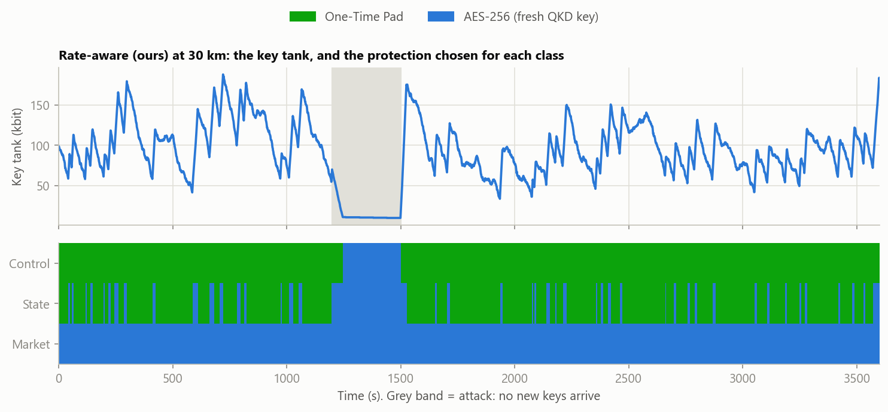

# Rate-Aware Key-Usage Policy with Safe AES-256 Fallback for QKD-Secured Smart Grid Links

Minor project, Objective 3. A Python simulator of one QKD-secured smart-grid link. Every second, QKD adds
secret key bits to a key tank and grid messages use them. The simulator compares five rules for deciding when
a message should use a One-Time Pad (OTP) and when it should fall back to AES-256 with a fresh QKD key,
including during an eavesdropping attack that stops key generation.

The project report (papers, methods, results, limitations) is submitted separately to the department.

## Online dashboard

**Live dashboard: https://qkd-key-policy.streamlit.app**

The dashboard runs in the browser without installing anything (Streamlit Community Cloud). It runs the same
simulator as the code below. If the page says the app is asleep, press the button to wake it up; it starts in
about a minute.

## How it works

- **Keys are scarce.** QKD fills a key tank. On a 30 km fibre it makes about 6,743 secret bits per second
  (Tang's model). The grid sends about 80 messages per second, and a One-Time Pad message costs 128 key bits
  (64-bit message + 64-bit one-time tag), so protecting everything with OTP would need 10,240 bit/s.
- **Two ways to protect a message.** OTP (proven unbreakable, 128 key bits per message) or AES-256-GCM
  (one 256-bit QKD key every 60 s for all messages, almost no key use).
- **Attacks stop key generation.** An eavesdropper raises the error rate (QBER); above 11% the keys are thrown
  away, so no new keys arrive during the attack.
- **Our rule.** Every second, for each message class in order of importance (control, state, market):
  `time_left = keys in tank / (OTP demand of this class and the more important ones - key supply)`.
  If `time_left` is below the class's safe time (20 s, 60 s, 120 s), that class uses AES-256. Market moves to
  AES first and control last; no message fails and no key is ever reused.

## Main results

30 km fibre, 300 s attack, mean of 30 one-hour runs (about 288,000 messages per run):

| Policy | Failed messages | Exposed messages (key reused) | Control messages on OTP |
|---|---|---|---|
| OTP-only | 113,172 | 0 | 91.6% |
| AES-only | 0 | 0 | 0% |
| Fixed reserve, 30 keys | 49.5 | 0 | 87.8% |
| Qian-style tiers | 26,931 | 172,516 | 68.0% |
| **Rate-aware (ours)** | **0** | **0** | **93.3%** |



*Our rule at 30 km (one run): the key tank (top) and the protection of each class (green: OTP, blue: AES-256).
Market stays on AES-256 because the keys cannot cover it, state switches whenever keys run short, and control
keeps OTP longest; it moves to AES-256 only during the attack (grey band), when no new keys arrive.*

## Run it

Needs Python 3.10 to 3.12.

```
pip install -r requirements.txt
run.bat                    # the dashboard: double-click it, or run  python -m streamlit run app.py
python run_one.py          # five policies, one run, 30 km fibre: prints a table (1 second)
python run_one.py 40       # same at 40 km
python -m pytest           # 32 automated checks
python experiments.py      # every experiment, 30 runs each: CSV tables and charts in results/ (1-2 minutes)
```

The dashboard has five tabs: a live animation of the five key tanks with the eavesdropper on the fibre,
the numbers of the current run (OTP share of every message class), the experiment charts, an explanation, and
a real OTP / AES-256 encryption of a grid command (including why a one-time pad must never be reused).
The fibre-length slider (1 to 100 km) also shows how many messages per second the keys can protect with OTP,
and for which classes that is enough.

## Files

| File | What it does | Based on |
|---|---|---|
| `params.py` | Every number, with its source (paper, PDF page) or marked ASSUMED | all papers |
| `keyrate.py` | Secret key rate from fibre length, QBER, wind-like swings, attack | Tang Eq. 4-6, 11, 15 and Table I; Rath |
| `traffic.py` | Messages per second for control, state estimation and market traffic | Qian p. 8 |
| `pool.py` | The key tank: add keys, take keys, count overflow | Zheng Eq. 1 |
| `policies.py` | OTP-only, AES-only, fixed reserve, Qian-style tiers, our rate-aware rule, plus an ablation | Alshowkan, Qian |
| `simulator.py` | The second-by-second loop | |
| `metrics.py` | Failed and exposed messages, OTP shares, wasted keys | Qian, Zheng Eq. 2 |
| `experiments.py` | All scenarios; thresholds tuned on 20 runs, results reported on 30 other runs | |
| `run_one.py` | Quick table for one distance | |
| `app.py` | The dashboard (Streamlit): sliders, tabs, real encryption demo | |
| `animation.py`, `web/animation.html` | The live animation of the five key tanks (plain HTML canvas, works offline) | |
| `run.bat` | Starts the dashboard and opens it in the browser | |
| `tests/` | Automated checks, e.g. key bits are conserved and OTP-only empties after 45 s as calculated by hand | |
| `results/` | CSV tables and charts produced by `experiments.py` | |

## The five policies

1. **OTP-only**: always OTP; messages fail when keys run out.
2. **AES-only**: always AES-256 with a QKD key refreshed every 60 s.
3. **Fixed reserve**: switch to AES below 30 keys (Alshowkan).
4. **Qian-style tiers**: keys by priority; when keys are scarce one key is shared by two messages (counted as exposed).
5. **Rate-aware (ours)**: for each class, predict the seconds until the tank is empty, counting only that class and
   more important ones; below the class's safe time (control 20 s, state 60 s, market 120 s) send it with AES-256.
   OTP may never spend the 512 bits kept for the next AES key; the tank uses OTP when nearly full; keys are never
   reused.

## Honest notes

- It is a simulation with a simplified (asymptotic) key-rate formula; no quantum hardware.
- Link values come from Tang's Table I. The pulse rate (2 MHz, from Qian) is chosen so the simplified formula gives
  Tang's order of key rate. Tank size, start stock, tag size, AES key life and wind swings are assumptions.
- An ablation (class-aware fixed reserve) shows most of the gain over a plain fixed reserve comes from per-class
  thresholds; the rate prediction adds about 1-4.5 points of control traffic on OTP and needs no tuning.
- The six reference papers are not included in this repository (publisher copyright).
