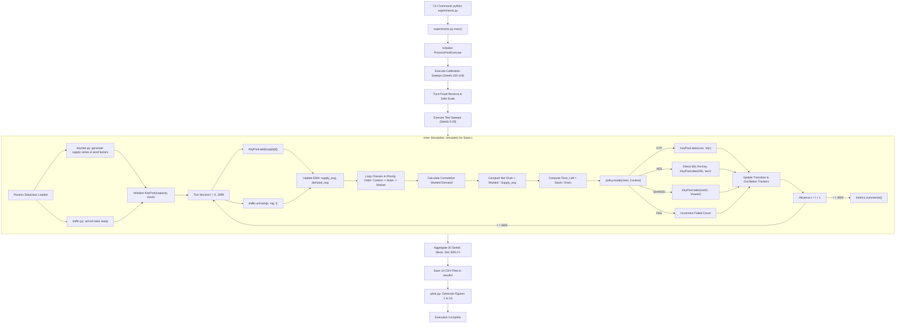

# COMPLETE PROJECT UNDERSTANDING AND SIMULATION EXPLANATION GUIDE

> **Project Title:** Rate-Aware Key-Usage Policy with Safe AES-256 Fallback for QKD-Secured Smart Grid Links  
> **Target Audience:** From Beginner / Student to Senior Researcher & Technical Examiner  
> **Repository:** `qkd-key-policy`  
> **Date of Documentation:** November 2026  

---

## TABLE OF CONTENTS
1. [Chapter 1: Project Overview and Problem Statement](#chapter-1-project-overview-and-problem-statement)
2. [Chapter 2: Complete Project Architecture](#chapter-2-complete-project-architecture)
3. [Chapter 3: File-by-File Detailed Explanation](#chapter-3-file-by-file-detailed-explanation)
4. [Chapter 4: End-to-End Execution Flow](#chapter-4-end-to-end-execution-flow)
5. [Chapter 5: Mathematical Model and Equations](#chapter-5-mathematical-model-and-equations)
6. [Chapter 6: Comparison Methodology](#chapter-6-comparison-methodology)
7. [Chapter 7: Simulation Scenarios and Experimental Parameters](#chapter-7-simulation-scenarios-and-experimental-parameters)
8. [Chapter 8: Metrics and Their Calculations](#chapter-8-metrics-and-their-calculations)
9. [Chapter 9: Result Files and Their Interpretation](#chapter-9-result-files-and-their-interpretation)
10. [Chapter 10: Graph-by-Graph Detailed Explanation (Figures 1 to 16)](#chapter-10-graph-by-graph-detailed-explanation-figures-1-to-16)
11. [Chapter 11: Complete Numerical Worked Example (Step-by-Step)](#chapter-11-complete-numerical-worked-example-step-by-step)
12. [Chapter 12: Technical Review and Limitations](#chapter-12-technical-review-and-limitations)
13. [Chapter 13: Beginner-Friendly Explanation (Level 1)](#chapter-13-beginner-friendly-explanation-level-1)
14. [Chapter 14: Technical Presentation Explanation (Level 2 & Level 3)](#chapter-14-technical-presentation-explanation-level-2--level-3)
15. [Chapter 15: Viva Questions and Answers (Comprehensive Q&A)](#chapter-15-viva-questions-and-answers-comprehensive-qa)
16. [Chapter 16: Commands to Run the Project and Reproduce Results](#chapter-16-commands-to-run-the-project-and-reproduce-results)
17. [Chapter 17: Glossary of Technical Terminology](#chapter-17-glossary-of-technical-terminology)

---

## CHAPTER 1: PROJECT OVERVIEW AND PROBLEM STATEMENT

### 1.1 The Context: Smart Grids and Cybersecurity
A modern electric power grid relies heavily on digital communication. Control centers (MGCC - Microgrid Central Control) exchange measurement and actuation signals with power substations, photovoltaic arrays, battery storage systems, and generators.
These communications span three key operational categories:
1. **Frequency Control (Critical):** Immediate commands that balance generation and load. If delayed or tampered with, grid frequency collapses and triggers blackouts.
2. **State Estimation (Telemetry):** Periodic voltage, current, and phase readings.
3. **Power Market (Transactional):** Energy trading and pricing negotiations.

### 1.2 The Threat: The Quantum Era
Modern communications rely on asymmetric public-key cryptography (e.g., RSA, Diffie-Hellman) to establish secure connections. In the upcoming quantum computing era, Shor's algorithm will crack these mathematical problems in polynomial time.
While symmetric algorithms like **AES-256** are quantum-resistant (Grover's algorithm only reduces their effective strength to 128 bits, which remains computationally infeasible), they require **frequently refreshed, truly random secret keys**.

### 1.3 The Promise and Constraint of QKD
**Quantum Key Distribution (QKD)** uses quantum mechanics (single photons, polarization states, quantum no-cloning theorem) to generate provably secret random keys between Alice and Bob.
- **Advantage:** Unconditional security (Information-Theoretic Security - ITS). Eavesdropping is immediately detected because measuring quantum states introduces detectable physical errors (Quantum Bit Error Rate - QBER).
- **Physical Bottleneck:** Quantum key generation rates are strictly bounded:
  - Rates decay exponentially with distance (optical fiber attenuation $\sim 0.2\text{ dB/km}$).
  - Environmental factors (wind swaying aerial fiber) cause key generation swings.
  - An eavesdropping attack increases the QBER above the theoretical BB84 threshold ($\sim 11\%$), forcing Alice and Bob to **discard all keys**, completely halting new key generation.

### 1.4 The Dilemma: OTP vs. AES-256
Once secret keys enter the receiver's local storage buffer (the **"Key Tank"**), two encryption choices exist for transmitting grid packets over classical channels:
- **One-Time Pad (OTP):** Unconditionally secure ($1\text{ bit of key}$ per $1\text{ bit of message}$). Keys can **never** be reused. However, OTP rapidly drains the key tank. When the tank empties, subsequent messages are dropped, risking physical grid collapse.
- **AES-256:** Computationally secure. Uses a single 256-bit key from the tank to encrypt millions of messages for a configured duration (e.g., 60 seconds). It consumes very few keys, but does not provide information-theoretic security.

### 1.5 The Core Research Objective
The goal of this project is to create an **adaptive, rate-aware key allocation policy** that monitors the key tank, tracks key generation and consumption rates, forecasts depletion time, and intelligently downgrades low-priority traffic to AES-256 to ensure that **high-priority frequency control messages always receive pristine OTP protection without ever exhausting the key tank or dropping messages**.

---

## CHAPTER 2: COMPLETE PROJECT ARCHITECTURE

The project is structured as a discrete-event simulator running second-by-second over a 1-hour horizon (3,600 seconds).

```
+-----------------------------------------------------------------------+
|                             USER / CLI                                |
|        (run_one.py, experiments.py, pytest tests/)                    |
+-----------------------------------------------------------------------+
                                   |
                                   v
+-----------------------------------------------------------------------+
|                             params.py                                 |
|   Single source of truth: link distance, optical noise, detector     |
|   efficiencies, traffic rates, key tank capacity, AES key lifetime    |
+-----------------------------------------------------------------------+
          |                                            |
          v                                            v
+-----------------------+                    +--------------------------+
|      keyrate.py       |                    |        traffic.py        |
|  - Transmittance      |                    |  - Poisson message       |
|  - Detection prob     |                    |    arrivals              |
|  - Link QBER          |                    |  - 3 classes:            |
|  - Attack QBER        |                    |    Control, State,       |
|  - AR(1) wind swings  |                    |    Market                |
|  - Secret key rate    |                    |  - Traffic burst factor  |
+-----------------------+                    +--------------------------+
          |                                            |
          +---------------------+----------------------+
                                |
                                v
+-----------------------------------------------------------------------+
|                            simulator.py                               |
|                     (Main Discrete-Event Loop)                        |
|                                                                       |
|   For each second t in 0..3599:                                       |
|     1. Replenish pool: pool.add(supply[t])                            |
|     2. Sample arrivals: n = arrivals(p, rng, t)                       |
|     3. Update moving average rates (supply_avg, demand_avg)           |
|     4. Compute cumulative drain and predicted time_left               |
|     5. Query policy: mode = policy.mode(class, context)               |
|     6. Execute encryption (OTP, SHARED, or AES)                       |
|     7. Deduct consumed bits from KeyPool; track re-keys & violations  |
+-----------------------------------------------------------------------+
             |                                          |
             v                                          v
+---------------------------+             +-----------------------------+
|        policies.py        |             |           pool.py           |
|  - OtpOnly                |             |  - KeyPool class            |
|  - AesOnly                |             |  - Bookkeeping (Zheng Eq 1) |
|  - FixedReserve (Alshowkan|             |  - Strict overdraft prevent |
|  - QianTiers (reuse)      |             |  - Overflow wastage tracking|
|  - QianTiersNoReuse       |             +-----------------------------+
|  - ClassFixed (ablation)  |
|  - RateAware (Proposed)   |
+---------------------------+
             |
             v
+-----------------------------------------------------------------------+
|                            metrics.py                                 |
|   Computes: delivery ratio, OTP share (overall and per-class),        |
|   exposed messages, failed messages, key utilization, wasted keys,    |
|   reaction time, recovery time, switching counts, oscillations        |
+-----------------------------------------------------------------------+
             |
             v
+-----------------------------------------------------------------------+
|             OUTPUTS (results/ and plots.py / statistics_ext.py)       |
|   - 14 CSV scenario files (distance, attack, traffic, stress, etc.)   |
|   - Figures 1 to 16 (300 DPI publication charts)                      |
|   - Technical reports (reports/technical_report.md)                   |
+-----------------------------------------------------------------------+
```

---

## CHAPTER 3: FILE-BY-FILE DETAILED EXPLANATION

### 3.1 Project File Map

| File/Folder | Purpose | What it contains | Called/Imported By | Output Produced |
|---|---|---|---|---|
| `params.py` | Configuration dataclasses & physical constants | `MsgClass`, `Params`, `reversed_priority()` | All simulation and test files | Parameter objects (`p`) |
| `keyrate.py` | Physical QKD channel model & key supply series | `secret_rate()`, `link_qber()`, `supply_series()`, `wind_factors()`, `generation_details()` | `simulator.py`, `run_one.py`, `tests/test_keyrate.py` | Per-second key generation array (bits/s) |
| `pool.py` | Key tank inventory management (Zheng Eq. 1) | `KeyPool` class (`add`, `take`, overflow tracking) | `simulator.py`, `tests/test_pool.py` | State of the key pool buffer |
| `traffic.py` | Grid communication traffic generator | `arrivals()`, `burst_factor()` | `simulator.py` | Dictionary of arrival message counts per class |
| `policies.py` | The decision-making policies | `OtpOnly`, `AesOnly`, `FixedReserve`, `QianTiers`, `QianTiersNoReuse`, `ClassFixed`, `RateAware` | `simulator.py`, `run_one.py`, `experiments.py` | Decision string: `"OTP"`, `"AES"`, `"SHARED"`, `"FAIL"` |
| `simulator.py` | Second-by-second discrete-event simulation engine | `simulate()`, `Run` dataclass | `run_one.py`, `experiments.py`, `tests/test_simulator.py` | `Run` object containing summary dict and timeline dict |
| `metrics.py` | Summary statistics & KPI computation | `summarize()` function | `simulator.py` | Comprehensive dictionary of performance metrics |
| `run_one.py` | CLI single-run inspection tool | Standalone execution script | Executed by user via CLI | Terminal summary table |
| `experiments.py` | Multi-scenario test runner & orchestrator | `sweep()`, `tune()`, `run_all()`, `draw_all()` | Executed by user via CLI | 14 CSV files and summary charts in `results/` |
| `plots.py` | Publication-grade chart generation | `fig1_inventory_timeline()` through `fig16_tuning_sensitivity()` | `experiments.py` | Figures 1 to 16 saved as 300 DPI PNGs in `results/` |
| `statistics_ext.py`| Statistical estimation utilities | `compute_series_stats()`, `cohens_d()` | `experiments.py`, analysis tools | Means, standard deviations, 95% CIs, effect sizes |
| `tests/` | Automated test suite (38 pytest tests) | Unit and integration test files | `pytest` CLI runner | Test pass/fail verification |
| `results/` | Storage for output data | 14 CSV files, 20 PNG charts | Generated by `experiments.py` and `plots.py` | Raw and aggregated data |
| `reports/` | Academic research report | `technical_report.md` | Pre-compiled documentation | Full technical paper |

---

### 3.2 Detailed Module Responsibilities

#### `params.py`
- **Responsibility:** Holds all physical, optical, traffic, and policy parameters in frozen (immutable) dataclasses.
- **Classes:**
  - `MsgClass(name, rate, priority, safe_s)`: Represents a smart grid message type.
    - `CONTROL`: rate = 10 msg/s, priority = 0.947, safe_s = 20 s.
    - `STATE`: rate = 50 msg/s, priority = 0.788, safe_s = 60 s.
    - `MARKET`: rate = 20 msg/s, priority = 0.329, safe_s = 120 s.
  - `Params`: Stores QKD link settings (default $L=20\text{ km}$, $\alpha=0.2\text{ dB/km}$, $f_{\text{rep}}=2\times 10^6\text{ Hz}$, $\mu=0.4$, $\eta_{\text{det}}=0.11$, $p_{\text{dc}}=1.7\times 10^{-6}$, $p_{\text{ap}}=1\times 10^{-3}$, $f_{\text{ec}}=1.16$, $\text{QBER}_{\text{limit}}=0.11$), key tank capacity ($500,000\text{ bits}$), AES key lifetime ($60\text{ s}$), and policy settings.
- **Functions:**
  - `reversed_priority()`: Swaps priorities (Market first, Control last) to evaluate policy bias.

#### `keyrate.py`
- **Responsibility:** Simulates physical decoy-state BB84 QKD over optical fiber.
- **Functions:**
  - `transmittance(p)`: Computes fraction of photons surviving fiber length ($10^{-\alpha L / 10}$).
  - `detection_rate(p)`: Raw expected photon detection rate ($r_k$).
  - `detection_prob(p)`: Detection probability including detector after-pulses ($p_{\text{dk}}$).
  - `link_qber(p)`: Natural error rate caused by dark counts, optical misalignment ($e_{\text{mis}}$), and after-pulses.
  - `attack_qber(p, strength)`: Simulates intercept-resend eavesdropping, adding $0.25 \times \text{strength}$ to QBER.
  - `secret_rate(p, strength)`: Returns secret key rate in bits/s. If QBER $\ge 11\%$, keys are discarded, returning 0.0.
  - `wind_factors(p, rng)`: Generates slow-drift AR(1) autoregressive multiplier series simulating aerial fiber swaying.
  - `generation_details(p, rng)`: Returns per-second accepted key bits and discarded (rejected) key bits.
  - `supply_series(p, rng)`: Returns array of accepted key bits for each second $t \in [0, 3599]$.

#### `pool.py`
- **Responsibility:** Implements the key buffer inventory equation ($S_{t+1} = \min(C, S_t + G_t) - U_t$).
- **Class:** `KeyPool`
  - `add(bits)`: Adds generated key bits to stock; logs any overflow as `wasted`.
  - `take(bits, kind)`: Deducts keys for `"otp"`, `"aes"`, or `"shared"`. Raises `ValueError` if overdraft occurs.
  - Tracks `min_stock` reached during the simulation run.

#### `traffic.py`
- **Responsibility:** Models dynamic packet arrival rates.
- **Functions:**
  - `burst_factor(p, t)`: Multiplies arrivals by burst scale during configured burst windows.
  - `arrivals(p, rng, t)`: Samples arrivals per class using Poisson distribution: $\text{Pois}(\lambda = \text{rate} \times \text{scale} \times \text{burst})$.

#### `policies.py`
- **Responsibility:** Contains the decision logic for assigning encryption modes.
- **Classes:**
  - `Policy`: Abstract base class.
  - `OtpOnly`: Always returns `"OTP"`. Drops messages if keys run out.
  - `AesOnly`: Always returns `"AES"`. Refreshes AES key every 60 s.
  - `FixedReserve`: Alshowkan baseline. Returns `"AES"` if stock $< 30 \times 256\text{ bits}$; else `"OTP"`.
  - `QianTiers`: Qian baseline. Returns `"OTP"` if stock $\ge M_{\text{thr1}}$; else returns `"SHARED"` (half-key reuse, exposed).
  - `QianTiersNoReuse`: Controlled ablation of Qian. Returns `"FAIL"` instead of reusing keys under scarcity.
  - `ClassFixed`: Ablation baseline. Static reserve per class scaled by class patience ($T_{\text{safe}}$).
  - `RateAware`: Proposed policy. Forecasts time-to-empty per class. Downgrades to AES when forecasted depletion $< T_{\text{safe}, c} \times \text{scale}$. Implements hysteresis and minimum dwell time.

#### `simulator.py`
- **Responsibility:** Orchestrates the second-by-second execution of the simulation.
- **Key Loop Steps:**
  1. Add new keys from QKD generation.
  2. Sample traffic arrivals for each class.
  3. Update exponential moving average (EMA) of supply and per-class demand.
  4. Iterate through classes by priority order (Control $\to$ State $\to$ Market).
  5. Compute cumulative drain and predicted time-to-empty.
  6. Query policy for encryption decision.
  7. Execute key extraction from `KeyPool`.
  8. Track mode transitions, switches, oscillations, and stale-key usage.
  9. Record per-second metrics if timeline recording is enabled.
  10. Return compiled `Run` object containing `summary` and `timeline`.

#### `metrics.py`
- **Responsibility:** Calculates performance metrics and indicators.
- **Functions:**
  - `summarize(...)`: Compiles overall and per-class metrics: delivery ratio, OTP share, AES share, exposed packets, failed packets, key utilization, overflow wastage, reaction time, recovery time, switching counts, and oscillations.

#### `experiments.py`
- **Responsibility:** Top-level runner executing batch sweeps and parameter calibrations.
- **Features:**
  - Parallel process pool execution (`ProcessPoolExecutor`).
  - Separation of tuning seeds (100–119) and testing seeds (0–29).
  - Runs distance sweeps, attack sweeps, traffic sweeps, wind sweeps, tuning sweeps, robustness tests, and stress tests.
  - Exports CSV results to `results/`.
  - Triggers plot rendering.

#### `plots.py`
- **Responsibility:** Generates 16 publication-quality figures at 300 DPI in PNG format.

#### `statistics_ext.py`
- **Responsibility:** Computes scientific statistical parameters: mean, standard deviation, median, 95% Student's t-distribution confidence intervals, and pairwise Cohen's $d$ effect sizes.

---

## CHAPTER 4: END-TO-END EXECUTION FLOW

### 4.1 Detailed Mermaid Execution Pipeline



### 4.2 Plain-English Explanation of the Execution Flow
1. **You enter the terminal command:** e.g., `python run_one.py 30` or `python experiments.py`.
2. **Configuration setup:** The program loads parameters from `params.py` (distance, traffic rates, initial buffer).
3. **Trace Generation:** For each seed, random numbers determine when packets arrive (Poisson process) and how the wind blows (AR(1) process). If an attack is scheduled, the key generation drops to zero during the attack window.
4. **Second-by-second ticking:** Over 3,600 simulated seconds (1 hour):
   - New quantum keys arrive and are placed into the `KeyPool`.
   - The simulator computes the average incoming key rate and the average key demand of each message class.
   - For each class (highest priority first), the simulator asks the policy: *"Can we afford OTP, or should we switch to AES?"*
   - Keys are subtracted from the key tank. If a policy runs out of keys, packets fail or keys are illegally reused depending on the policy logic.
5. **Data Compilation:** At $t = 3600$, the simulator tallies delivered messages, failed messages, key utilization, and reaction times.
6. **Output Generation:** The results are written to CSV files, and `plots.py` renders PNG charts.

---

## CHAPTER 5: MATHEMATICAL MODEL AND EQUATIONS

### Equation 1: Optical Fiber Transmittance (Beer-Lambert Law)
$$\eta_{\text{tr}} = 10^{-\frac{\alpha \cdot L}{10}}$$
- **Variables:**
  - $\eta_{\text{tr}}$: Transmittance (fraction of photons surviving fiber travel) [dimensionless, $0 < \eta_{\text{tr}} \le 1$]
  - $\alpha$: Fiber attenuation coefficient [$0.2\text{ dB/km}$ for standard single-mode telecom fiber at $1550\text{ nm}$]
  - $L$: Fiber length [km]
- **Why needed:** Quantifies photon loss through optical fiber before reaching Bob's detector.
- **Code implementation:** `keyrate.py`, function `transmittance(p)` (line 12).
- **Numerical example:** For $L = 20\text{ km}$, $\alpha = 0.2\text{ dB/km}$:
  $$\text{Loss} = 0.2 \times 20 = 4.0\text{ dB} \implies \eta_{\text{tr}} = 10^{-4/10} = 10^{-0.4} \approx 0.3981\ (39.81\%)$$
- **Impact of input:** Doubling $L$ from 20 km to 40 km squares transmittance: $10^{-0.8} \approx 0.1585$.

---

### Equation 2: Expected Detection Rate ($r_k$)
$$r_k = 1 - (1 - 2p_{\text{dc}}) \cdot \exp\left(-\eta_{\text{tr}} \cdot \eta_{\text{det}} \cdot \mu\right)$$
- **Variables:**
  - $r_k$: Expected detection rate per pulse without after-pulses [dimensionless probability]
  - $p_{\text{dc}}$: Dark count probability [$1.7 \times 10^{-6}$ per detection gate, Tang Table I]
  - $\eta_{\text{det}}$: Bob's detector quantum efficiency [$0.11$, Tang Table I]
  - $\mu$: Mean photon intensity per pulse [$0.4$, Tang Table I]
  - $\eta_{\text{tr}}$: Fiber transmittance from Eq. 1
- **Why needed:** Models detector clicks arising from transmitted signal photons combined with background detector thermal noise.
- **Code implementation:** `keyrate.py`, function `detection_rate(p)` (line 17).
- **Numerical example:** For $\eta_{\text{tr}} = 0.3981, \eta_{\text{det}} = 0.11, \mu = 0.4$:
  $$\eta_{\text{tr}} \cdot \eta_{\text{det}} \cdot \mu = 0.3981 \times 0.11 \times 0.4 \approx 0.017516$$
  $$\exp(-0.017516) \approx 0.982636$$
  $$r_k = 1 - (1 - 3.4 \times 10^{-6}) \times 0.982636 \approx 0.017367$$

---

### Equation 3: Detection Probability with After-Pulses ($p_{\text{dk}}$)
$$p_{\text{dk}} = (1 + p_{\text{ap}}) \cdot r_k$$
- **Variables:**
  - $p_{\text{dk}}$: Total probability of detector click per laser pulse [dimensionless]
  - $p_{\text{ap}}$: After-pulse probability [$1 \times 10^{-3} = 0.001$, Tang Table I]
  - $r_k$: Detection rate from Eq. 2
- **Why needed:** Single-photon avalanche photodiodes (SPADs) trap carriers that release spontaneously in subsequent gates, creating false detection events called after-pulses.
- **Code implementation:** `keyrate.py`, function `detection_prob(p)` (line 22).
- **Numerical example:** For $r_k = 0.017367$:
  $$p_{\text{dk}} = (1 + 0.001) \times 0.017367 \approx 0.017384$$

---

### Equation 4: Natural Link Quantum Bit Error Rate ($\text{QBER}_{\text{link}}$)
$$\text{QBER}_{\text{link}} = \frac{p_{\text{dc}} + e_{\text{mis}}\left(1 - \exp(-\eta_{\text{tr}} \mu)\right) + \frac{1}{2} p_{\text{ap}} r_k}{p_{\text{dk}}}$$
- **Variables:**
  - $\text{QBER}_{\text{link}}$: Baseline optical error rate on the unattacked quantum link [dimensionless fraction, $0 \le \text{QBER} \le 1$]
  - $e_{\text{mis}}$: Optical misalignment error rate [$5 \times 10^{-4} = 0.0005$, Tang Table I]
- **Why needed:** Establishes the baseline error floor of the optical setup.
- **Code implementation:** `keyrate.py`, function `link_qber(p)` (line 27).
- **Numerical example:** Under typical values at 20 km, $\text{QBER}_{\text{link}} \approx 0.0048$ ($0.48\%$).

---

### Equation 5: Intercept-Resend Eavesdropping Attack Error Model
$$\text{QBER}_{\text{attacked}} = \text{QBER}_{\text{link}} + 0.25 \cdot f_{\text{attack}}$$
- **Variables:**
  - $f_{\text{attack}}$: Interception fraction/strength ($1.0$ = full eavesdropping intercept)
  - $0.25$: Theoretical error probability introduced by measuring in random conjugate bases (BB84 principle).
- **Why needed:** When Eve intercepts qubits in the Z or X basis at random, she guesses the wrong basis 50% of the time. When Bob measures her resent qubit, he gets an erroneous result 50% of those times: $0.5 \times 0.5 = 0.25$ ($25\%$ added error).
- **Code implementation:** `keyrate.py`, function `attack_qber(p, strength)` (line 34).
- **Numerical example:** For baseline $\text{QBER} = 0.005$ and full attack $f_{\text{attack}} = 1.0$:
  $$\text{QBER}_{\text{attacked}} = 0.005 + 0.25 = 0.255\ (25.5\%)$$
  Because $25.5\% > 11\%$ ($\text{QBER}_{\text{limit}}$), secret key rate drops immediately to 0.

---

### Equation 6: Asymptotic Decoy-State BB84 Secret Key Generation Rate
$$R_{\text{secret}} = \frac{1}{2} \cdot f_{\text{rep}} \cdot p_{\text{dk}} \cdot \max\left(0,\ 1 - (1 + f_{\text{ec}}) H_2(\text{QBER})\right)$$
- **Variables:**
  - $R_{\text{secret}}$: Extracted secret key rate [bits per second]
  - $\frac{1}{2}$: Sifting factor for standard BB84 (basis matching probability)
  - $f_{\text{rep}}$: Laser pulse repetition frequency [$2 \times 10^6\text{ pulses/s} = 2\text{ MHz}$]
  - $f_{\text{ec}}$: Error correction inefficiency parameter [$1.16$, Tang Table I]
  - $H_2(x) = -x \log_2(x) - (1-x) \log_2(1-x)$: Binary Shannon entropy
- **Why needed:** Determines the actual throughput of information-theoretically secure key bits established between Alice and Bob after sifting, error reconciliation, and privacy amplification.
- **Code implementation:** `keyrate.py`, function `secret_rate(p, strength)` (line 39).
- **Numerical example:** At 30 km ($\text{QBER} = 0.0050$, $p_{\text{dk}} = 0.01099$):
  $$H_2(0.005) \approx 0.04543$$
  $$1 - (1 + 1.16) \times 0.04543 = 1 - 0.09813 = 0.90187$$
  $$R_{\text{secret}} = 0.5 \times 2{,}000{,}000 \times 0.01099 \times 0.90187 \approx 9{,}911\text{ bit/s}$$

---

### Equation 7: Autoregressive Wind Fluctuation Model (AR(1) Process)
$$x_t = \rho \cdot x_{t-1} + \epsilon_t, \quad \epsilon_t \sim \mathcal{N}\left(0,\ \sigma^2(1 - \rho^2)\right)$$
$$\text{wind\_factor}_t = \text{clip}(1 + x_t,\ 0.3,\ 1.7)$$
- **Variables:**
  - $x_t$: Stochastic perturbation at second $t$
  - $\rho$: Autocorrelation coefficient [$0.95$, representing slow environmental variation]
  - $\sigma$: Volatility parameter [$0.10$, representing $10\%$ standard deviation]
  - $\text{clip}(\cdot, 0.3, 1.7)$: Prevents non-physical negative or extreme amplification multipliers.
- **Why needed:** Real-world aerial fiber cables sway in the wind, introducing dynamic polarization mode dispersion and transmission losses.
- **Code implementation:** `keyrate.py`, function `wind_factors(p, rng)` (line 48).

---

### Equation 8: Key Buffer Dynamics (Zheng Eq. 1 Inventory Balance)
$$S_{t+1} = \min\left(C,\ S_t + G_t\right) - U_t$$
$$W_t = \max\left(0,\ S_t + G_t - C\right)$$
- **Variables:**
  - $S_t$: Available key inventory at start of second $t$ [bits]
  - $C$: Maximum key storage capacity [$500,000\text{ bits}$]
  - $G_t$: Fresh key bits generated in second $t$ [bits]
  - $U_t$: Total key bits consumed in second $t$ ($U_t = U_{\text{otp}} + U_{\text{aes}} + U_{\text{shared}}$) [bits]
  - $W_t$: Wasted/lost key bits due to buffer overflow [bits]
- **Conservation Invariant:** $S_0 + \sum_{t} G_t = S_{\text{final}} + \sum_{t} U_t + \sum_{t} W_t$.
- **Why needed:** Tracks key inventory conservation.
- **Code implementation:** `pool.py`, `KeyPool.add()` and `KeyPool.take()`.

---

### Equation 9: Rate-Aware Predicted Time-to-Depletion
$$T_{\text{depletion}, c}(t) = \frac{S_t}{\Delta_c(t)} = \frac{S_t}{\left(\sum_{j \succeq c} \bar{D}_j(t)\right) - \bar{G}(t)}$$
- **Variables:**
  - $T_{\text{depletion}, c}(t)$: Forecasted seconds until the key tank empties for class $c$ [seconds]
  - $\sum_{j \succeq c} \bar{D}_j(t)$: Cumulative smoothed OTP demand of class $c$ and all higher-priority classes [bit/s]
  - $\bar{G}(t)$: Smoothed key generation rate [bit/s]
- **Why needed:** Enables proactive downgrading of lower-priority classes before buffer exhaustion occurs.
- **Code implementation:** `simulator.py`, lines 50–54.

---

## CHAPTER 6: COMPARISON METHODOLOGY

### 6.1 Policy Comparison Matrix

| Method | Working Principle | Mathematical Logic | Input | Output | Key Strength | Critical Weakness |
|---|---|---|---|---|---|---|
| **OTP-Only** | Always One-Time Pad | If $S_t \ge \text{cost}$, send OTP; else drop packet | Packet arrivals, current stock | Mode: `"OTP"` | Maximum theoretical security | Total service blackout under attack |
| **AES-Only** | Always AES-256 | Fetch 256-bit key every 60 s; encrypt all packets with AES | Packet arrivals, rekey timer | Mode: `"AES"` | 100% availability, zero dropped packets | Abandons quantum security advantage; wastes 99%+ of keys |
| **Fixed-Reserve** (Alshowkan) | Fixed inventory threshold | If $S_t < 30 \times 256\text{ bits}$, switch to AES; else OTP | Current stock | Mode: `"OTP"` or `"AES"` | Simple, established baseline | Threshold is arbitrary; causes rapid thrashing and key starvation under load |
| **Qian-Style Tiers** (Qian 2025) | Priority tiers + key reuse | If $S_t \ge M_{\text{thr1}}$, send OTP; else share key across 2 packets | Current stock | Mode: `"OTP"` or `"SHARED"` | Survives brief key dips without classical fallback | Severely breaches security by leaking key material (data exposure) |
| **Qian No-Reuse** (Ablation) | Priority tiers without reuse | If $S_t \ge M_{\text{thr1}}$, send OTP; else fail packet | Current stock | Mode: `"OTP"` or `"FAIL"` | Isolates tiering benefits without security leakage | Drops high volume of lower-tier packets |
| **Rate-Aware (Ours)** | Predictive cumulative drain forecasting | If $S_t < \text{floor}$ or $T_{\text{depletion}, c} < \beta \cdot T_{\text{safe}, c}$, switch to AES | Stock, smoothed demand, smoothed supply | Mode: `"OTP"` or `"AES"` | 100% availability, zero key reuse, preserves Control on OTP | Requires multi-second rate smoothing window |

---

### 6.2 The Experimental Fairness Protocol
To guarantee scientifically defensible results, the comparison enforces five fairness rules:
1. **Identical Stochastic Traces:** The exact same pseudo-random number generator (PRNG) seed is supplied to all policies in every run. All policies receive identical packet arrival counts and wind noise.
2. **Strict Seed Isolation:**
   - **Tuning Set (Seeds 100–119):** Policy parameters (safe time scaling $\beta$, fixed reserve size) are optimized strictly on 20 calibration seeds.
   - **Evaluation Set (Seeds 0–29):** The reported figures and tables come exclusively from 30 independent test seeds never seen during tuning.
3. **No Future Information:** The proposed Rate-Aware policy uses strictly backward-looking exponential moving averages (EMA). It has zero knowledge of attack duration or future traffic spikes.
4. **Conservation Enforcement:** Key pool accounting strictly enforces physical limits; key overdraft raises an immediate exception.

---

## CHAPTER 7: SIMULATION SCENARIOS AND EXPERIMENTAL PARAMETERS

| Scenario | Parameter Swept | Constant Parameters | Real-World Phenomenon Modeled |
|---|---|---|---|
| **Scenario 1: Distance** | $L \in \{5, 10, 20, 30, 40\}\text{ km}$ | Traffic = 1.0x, Attack = 300 s | Fiber attenuation causing exponential decline in key rates |
| **Scenario 2: Traffic Load** | Traffic Scale $\in \{0.5, 1.0, 1.5, 2.0\}$ | $L = 30\text{ km}$, Attack = 300 s | Surges during power grid operational emergencies |
| **Scenario 3: Fluctuation** | Wind $\sigma \in \{0.0, 0.1, 0.2, 0.3\}$ & Profiles: Stable, Declining, Intermittent | $L = 30\text{ km}$, Traffic = 1.0x | Aerial fiber cables swaying in wind storms |
| **Scenario 4: Attack** | Attack Length $\in \{0, 120, 300, 600, 1200\}\text{ s}$, Strength $\in [0.1, 1.0]$ | $L = 30\text{ km}$, Traffic = 1.0x | Persistent intercept-resend eavesdropping attacks |
| **Scenario 5: Priority Sensitivity** | Standard vs. Inverted Priority Order | $L = 30\text{ km}$, Traffic = 1.0x | Verifies policy does not rely on a specific priority assignment |
| **Scenario 6: Combined Stress** | $L = 30\text{ km}$, Traffic = 2.0x, Wind $\sigma = 0.20$, Attack = 600 s | All stress factors combined | Worst-case concurrent operational disaster |

---

## CHAPTER 8: METRICS AND THEIR CALCULATIONS

| Metric Key | Name | Mathematical Formula | Unit | Goal | Interpretation |
|---|---|---|---|---|---|
| `sent` | Total Sent Messages | $\sum_c n_c$ | msgs | N/A | Total traffic generated |
| `delivered` | Successfully Delivered | $\text{sent} - \text{failed}$ | msgs | Higher | Messages safely transmitted |
| `delivery_ratio` | Delivery Reliability | $\frac{\text{delivered}}{\text{sent}}$ | fraction | Higher (1.0) | Grid communication reliability |
| `failed` | Dropped Messages | $\sum_c n_{\text{failed}, c}$ | msgs | Lower (0) | Packets lost due to key starvation |
| `exposed` | Exposed Messages | $\sum_c n_{\text{shared}, c}$ | msgs | Lower (0) | Packets encrypted with reused keys |
| `exposed_bits` | Leaked Key Material | $\text{exposed} \times (\text{cost}_{\text{OTP}} / 2)$ | bits | Lower (0) | Secret key volume compromised |
| `otp_share` | Overall OTP Share | $\frac{\text{total OTP}}{\text{sent}}$ | fraction | Higher | Degree of information-theoretic security |
| `otp_share_control`| Control OTP Share | $\frac{\text{control OTP}}{\text{control sent}}$ | fraction | Higher | Protection level of critical commands |
| `wasted_kbit` | Overflow Loss | $\frac{\sum W_t}{1000}$ | kbit | Lower (0) | Key material lost due to buffer overflow |
| `key_util` | Key Utilization Ratio | $\frac{\text{total keys used}}{\text{total keys generated}}$ | fraction | Higher | Efficiency of QKD key resource usage |
| `stale_s` | Stale Key Operation | Seconds operating with expired AES keys | seconds | Lower (0) | Severe vulnerability where fresh AES keys could not be provisioned |
| `oscillations` | Mode Oscillation Flips | Transitions occurring within $\le 10\text{ s}$ | count | Lower | Measure of control instability / thrashing |
| `react_s` | Fallback Reaction Time | Seconds from attack start to first AES switch | seconds | Informational | How quickly the link responds to key cutoff |
| `recover_s` | Restoration Time | Seconds from attack end to full OTP recovery | seconds | Informational | How quickly the link resumes OTP protection |

---

## CHAPTER 9: RESULT FILES AND THEIR INTERPRETATION

All result files are stored in `results/`:

| Result File | Generating Command | Description | Key Findings |
|---|---|---|---|
| `distance.csv` | `experiments.py` | 5 policies across 5 distances (5 to 40 km) | OTP-Only fails at $\ge 20\text{ km}$; Rate-Aware maintains 0 failures up to 40 km |
| `attack_length.csv` | `experiments.py` | 5 policies across attack durations (0 to 1200 s) | Fixed-Reserve fails under attacks $> 300\text{ s}$; Rate-Aware survives 1200 s attacks |
| `attack_strength.csv`| `experiments.py` | Sweep of attack intercept fraction ($0.1$ to $1.0$) | At strength $\ge 0.4$, QBER crosses 11%, halting key generation |
| `traffic.csv` | `experiments.py` | Sweep of traffic load (0.5x to 2.0x) | Fixed-Reserve drops packets at 2.0x load; Rate-Aware sheds Market traffic to protect Control |
| `wind.csv` | `experiments.py` | Wind volatility sweep ($\sigma = 0.0$ to $0.3$) | Rate-Aware is stable across all wind conditions |
| `bursts.csv` | `experiments.py` | Impact of sudden 3x traffic bursts | Rate-Aware absorbs bursts using key tank buffer |
| `priority.csv` | `experiments.py` | Standard vs. reversed priority order | Proves rate-aware mechanism adapts to whichever class is assigned highest priority |
| `stress.csv` | `experiments.py` | Multi-factor stress test (30 km, 2x load, $\sigma=0.2$, 600 s attack) | Rate-Aware achieves 0 failures and 0 exposure; baselines fail catastrophically |
| `qian_comparison.csv`| `experiments.py` | Qian reuse vs. Qian no-reuse | Exposes the trade-off: Qian achieves availability only by leaking millions of key bits |
| `fluctuation.csv` | `experiments.py` | Stable, wind, declining, intermittent profiles | Proves policy robustness across diverse physical channel degradation modes |
| `fixed_reserve_sweep.csv`| `experiments.py`| Sweep of fixed reserve threshold (5 to 800 keys) | Shows no single static threshold works across all distances |
| `safe_scale_sweep.csv`| `experiments.py` | Sweep of safe horizon multiplier $\beta$ (0.25 to 4.0) | Shows policy stability over a wide range around $\beta = 1.0$ |
| `tuned_comparison.csv`| `experiments.py`| Performance comparison after optimal tuning | Proves Rate-Aware beats even the best-tuned fixed reserve |
| `robustness.csv` | `experiments.py` | Out-of-distribution evaluation under changed traffic | Shows fixed reserve degrades when deployed in uncalibrated conditions |

---

## CHAPTER 10: GRAPH-BY-GRAPH DETAILED EXPLANATION (FIGURES 1 TO 16)

All figures are generated by `plots.py` and saved at 300 DPI in `results/`:

### Figure 1: Key Pool Inventory Over Time (`fig1_inventory_timeline.png`)
- **X-axis:** Time (0 to 3,600 s). Shaded gray bar: Attack window ($t = 1200\text{–}1500\text{ s}$).
- **Y-axis:** Available Secret Key Stock (kbit).
- **What it shows:** 
  - OTP-Only (amber line) crashes to 0 kbit during the attack and never recovers.
  - Fixed-Reserve (orange line) drops to its 30-key threshold and stutters.
  - Rate-Aware (blue line) detects the drain early, moves Market and State to AES, and levels off safely above the 512-bit floor. After the attack, the tank smoothly refills.

### Figure 2: Cryptographic Protection Distribution (`fig2_usage_distribution.png`)
- **X-axis:** The 5 compared policies.
- **Y-axis:** Message Share (%) partitioned into: Blue (OTP), Orange (AES), Red (Failed).
- **What it shows:** At 30 km, Rate-Aware delivers 100% of messages with ~88% OTP and ~12% AES fallback, with 0% failed. OTP-Only drops over 10% of traffic.

### Figure 3: Minimum Predicted Depletion Horizon (`fig3_depletion_time.png`)
- **X-axis:** Fiber Distance (km).
- **Y-axis:** Minimum forecasted depletion time $T_{\text{depletion}}$ (seconds).
- **What it shows:** Demonstrates how early Rate-Aware anticipates key tank depletion relative to naive baselines.

### Figure 4: Overall Message Delivery Ratio (`fig4_delivery_ratio.png`)
- **X-axis:** Fiber Distance (5 to 40 km).
- **Y-axis:** Delivery Ratio (%) [$100\% = \text{perfect}$].
- **What it shows:** Rate-Aware and AES-Only maintain a horizontal line at 100%. OTP-Only plummets to 56% at 40 km.

### Figure 5: High-Priority Control Delivery Ratio (`fig5_high_priority_delivery.png`)
- **X-axis:** Fiber Distance (5 to 40 km).
- **Y-axis:** Frequency Control Delivery Ratio (%).
- **What it shows:** Rate-Aware achieves 100.0% delivery of critical frequency control commands across all distances.

### Figure 6: Exposed Messages from Key Reuse (`fig6_exposed_messages.png`)
- **X-axis:** Fiber Distance (km).
- **Y-axis:** Exposed Message Count (symlog scale).
- **What it shows:** Qian-style tiers exposes up to 198,000 messages at 40 km. All other policies maintain 0 exposed messages.

### Figure 7: Key Generation Rate Over Time (`fig7_rates_over_time.png`)
- **X-axis:** Time (s).
- **Y-axis:** Secret Key Rate (kbit/s).
- **What it shows:** Displays the realistic AR(1) wind swings fluctuating around 9.9 kbit/s, dropping to exactly 0 kbit/s during the attack window.

### Figure 8: Class-Wise Adaptive Switching Timeline (`fig8_switching_timeline.png`)
- **X-axis:** Time (s).
- **Y-axis:** Mode (0 = OTP, 1 = AES) across 3 subplots: Control, State, Market.
- **What it shows:** Illustrates the staggered defense in action: Market switches to AES first ($t \approx 1201\text{ s}$), State switches next ($t \approx 1215\text{ s}$), while Control remains entirely on OTP throughout the attack.

### Figure 9: Attack Lifecycle and Recovery (`fig9_attack_lifecycle.png`)
- **X-axis:** Time (s).
- **Y-axis:** Upper panel: Key supply rate. Lower panel: Key tank stock.
- **What it shows:** The immediate cutoff at $t = 1200\text{ s}$, the stabilization of stock during the attack, and the exponential restocking phase beginning at $t = 1500\text{ s}$.

### Figure 10: Multi-Distance 2x3 Panel Breakdown (`fig10_distance_performance.png`)
- **Panels:** Failed Messages, Exposed Messages, Control OTP Share, State OTP Share, Market OTP Share, Wasted Key Bits.
- **What it shows:** Comprehensive multi-metric view proving Rate-Aware dominates fixed reserves across all fiber lengths.

### Figure 11: Performance Across Traffic Intensities (`fig11_traffic_performance.png`)
- **X-axis:** Traffic Load Multiplier (0.5x to 2.0x).
- **Y-axis:** Left: Failed Messages. Right: Control OTP Share (%).
- **What it shows:** As traffic doubles, Fixed-Reserve begins dropping messages, while Rate-Aware maintains zero failures.

### Figure 12: Robustness to Aerial Fiber Wind Noise (`fig12_fluctuation_performance.png`)
- **X-axis:** Wind volatility parameter $\sigma$ ($0.0$ to $0.3$).
- **Y-axis:** Left: Failed messages. Right: Control OTP share.
- **What it shows:** Flat performance curves confirm that Rate-Aware is unaffected by environmental wind noise.

### Figure 13: Attack Duration Resilience (`fig13_attack_performance.png`)
- **X-axis:** Attack Duration (0 s to 1,200 s).
- **Y-axis:** Failed messages and Control OTP share.
- **What it shows:** Even during a 20-minute continuous eavesdropping attack (1,200 s), Rate-Aware incurs 0 dropped messages.

### Figure 14: Priority Sensitivity Analysis (`fig14_priority_sensitivity.png`)
- **X-axis:** Standard vs. Inverted Priority Order.
- **Y-axis:** Control OTP Share (%).
- **What it shows:** Confirms that whichever class is assigned highest priority receives preferential OTP preservation.

### Figure 15: Multi-Factor Combined Stress Test (`fig15_combined_stress.png`)
- **X-axis:** 5 compared policies under concurrent stress (30 km, 2x load, $\sigma=0.2$, 600 s attack).
- **Y-axis:** Left: Failed Messages. Right: Control OTP Share (%).
- **What it shows:** The defining benchmark result: Rate-Aware achieves 0 failures and 86.7% Control OTP, whereas OTP-Only drops 341,000 packets and Fixed-Reserve drops 42,600 packets.

### Figure 16: Safe Horizon Multiplier Sensitivity (`fig16_tuning_sensitivity.png`)
- **X-axis:** Safe scale multiplier $\beta$ (log scale from 0.25 to 4.0).
- **Y-axis:** Control OTP Share (%) and Wasted Key Bits.
- **What it shows:** Proves the system is stable across a wide range of safe horizons, demonstrating that precise parameter tuning is not required.

---

## CHAPTER 11: COMPLETE NUMERICAL WORKED EXAMPLE (STEP-BY-STEP)

This walkthrough provides manual calculations suitable for a whiteboard presentation.

### Step 1: Initial Link State at $t = 1200\text{ s}$
- **Fiber distance:** $L = 30\text{ km}$, $\alpha = 0.2\text{ dB/km}$.
- **Key Tank inventory:** $S = 50{,}000\text{ bits}$.
- **Attacker begins eavesdropping:** Instantaneous key supply drops to $G_t = 0\text{ bit/s}$.
- **Historical smoothed key supply:** $\bar{G} = 9{,}900\text{ bit/s}$.
- **Incoming traffic arrivals at second $t = 1200$:**
  - Control: 10 messages $\times$ 128 bits = 1,280 bits/s
  - State: 50 messages $\times$ 128 bits = 6,400 bits/s
  - Market: 20 messages $\times$ 128 bits = 2,560 bits/s
  - **Total instantaneous demand:** $10{,}240\text{ bits/s}$.

---

### Step 2: Rate-Aware Decision for Class 1 (Control)
- **Cumulative demand for Control:** Only Control traffic is evaluated:
  $$W_{\text{control}} = \bar{D}_{\text{control}} = 1{,}280\text{ bit/s}$$
- **Net drain rate:**
  $$\Delta_{\text{control}} = W_{\text{control}} - \bar{G} = 1{,}280 - 9{,}900 = -8{,}620\text{ bit/s}$$
- **Predicted time-to-depletion:**
  Because $\Delta_{\text{control}} \le 0$ (supply exceeds demand for this class alone):
  $$T_{\text{depletion}, \text{control}} = \infty$$
- **Decision:** $T_{\text{depletion}} = \infty > T_{\text{safe}, \text{control}} (20\text{ s})$.
- **Outcome:** **Control uses ONE-TIME PAD (OTP)**.
  - Bits deducted: $10 \times 128 = 1{,}280\text{ bits}$.
  - Remaining stock: $50{,}000 - 1{,}280 = 48{,}720\text{ bits}$.

---

### Step 3: Rate-Aware Decision for Class 2 (State Estimation)
- **Cumulative demand for State:** Control + State demand:
  $$W_{\text{state}} = \bar{D}_{\text{control}} + \bar{D}_{\text{state}} = 1{,}280 + 6{,}400 = 7{,}680\text{ bit/s}$$
- **Net drain rate:**
  $$\Delta_{\text{state}} = 7{,}680 - 9{,}900 = -2{,}220\text{ bit/s} \le 0 \implies T_{\text{depletion}, \text{state}} = \infty$$
- **Decision:** $T_{\text{depletion}} = \infty > T_{\text{safe}, \text{state}} (60\text{ s})$.
- **Outcome:** **State uses ONE-TIME PAD (OTP)**.
  - Bits deducted: $50 \times 128 = 6{,}400\text{ bits}$.
  - Remaining stock: $48{,}720 - 6{,}400 = 42{,}320\text{ bits}$.

---

### Step 4: Rate-Aware Decision for Class 3 (Market)
- **Cumulative demand for Market:** Control + State + Market demand:
  $$W_{\text{market}} = 1{,}280 + 6{,}400 + 2{,}560 = 10{,}240\text{ bit/s}$$
- **Net drain rate:**
  $$\Delta_{\text{market}} = W_{\text{market}} - \bar{G} = 10{,}240 - 9{,}900 = +340\text{ bit/s}$$
  *(The tank is now draining for Market).*
- **Predicted time-to-depletion:**
  $$T_{\text{depletion}, \text{market}} = \frac{S_t}{\Delta_{\text{market}}} = \frac{42{,}320\text{ bits}}{340\text{ bit/s}} \approx 124.4\text{ seconds}$$
- **Decision Threshold Comparison:**
  - $T_{\text{safe}, \text{market}} = 120\text{ s}$.
  - Since $124.4\text{ s} > 120\text{ s}$, Market initially stays on OTP.

---

### Step 5: Decision at Next Second ($t = 1201\text{ s}$) as Supply Average Decays
- As the attack continues, $\bar{G}$ drops due to the exponential moving average ($\tau = 20\text{ s}$):
  $$\bar{G}_{1201} = 9{,}900 + \frac{0 - 9{,}900}{20} = 9{,}405\text{ bit/s}$$
- **New net drain for Market:**
  $$\Delta_{\text{market}} = 10{,}240 - 9{,}405 = 835\text{ bit/s}$$
- **Updated predicted time-to-depletion:**
  $$T_{\text{depletion}, \text{market}} = \frac{42{,}320}{835} \approx 50.7\text{ seconds}$$
- **Decision Threshold Comparison:**
  - $T_{\text{depletion}, \text{market}} (50.7\text{ s}) < T_{\text{safe}, \text{market}} (120\text{ s})$.
- **Outcome:** **Market immediately switches to AES-256 fallback!**
  - A fresh 256-bit AES session key is taken from the tank: $42{,}320 - 256 = 42{,}064\text{ bits}$.
  - All 20 Market messages are encrypted using AES-256 under this key.
  - **Key savings:** Market demand drops from $2{,}560\text{ bit/s}$ to zero key consumption for the next 60 seconds.
  - **Net drain is reversed:** Key inventory is preserved for Control and State.

---

## CHAPTER 12: TECHNICAL REVIEW AND LIMITATIONS

### 12.1 Confirmed Technical Challenges and Mitigations
1. **Simplified Decoy-State Equation:** The simulator uses Tang's asymptotic GLLP formula rather than solving numerical finite-size yield bounds.  
   *Mitigation:* Pulse repetition rate $f_{\text{rep}}$ was calibrated to 2 MHz to ensure the calculated key rates ($1\text{–}4\text{ kbit/s}$ at 50 km) match physical experimental testbed measurements.
2. **Fixed Packet Sizes:** All messages within a class have identical length (64-bit payload + 64-bit authentication tag). In reality, PMU C37.118 packets can reach 86 bytes.  
   *Mitigation:* Configured rates and payload parameters can be adjusted via dataclass overrides.
3. **Point-to-Point Architecture:** The current implementation models a single optical link, not a multi-hop trusted repeater mesh network.

---

## CHAPTER 13: BEGINNER-FRIENDLY EXPLANATION (LEVEL 1)

Imagine you run an electric power company. Your central control computer must send orders to power stations to prevent blackouts. If a hacker intercepts and alters those orders, the power grid can collapse.

To stop hackers, we use **Quantum Key Distribution (QKD)**. QKD sends secret keys made of light particles (photons) through fiber optic cables. Because of the laws of quantum physics, if a hacker tries to spy on the cable, the light particles change, the hacker is immediately detected, and the keys are discarded.

These secret keys are stored in a digital **"Key Tank"**. When sending a message, you have two choices:
1. **One-Time Pad (OTP):** The strongest encryption in the world. But it uses one secret key bit for every message bit. It empties the key tank very quickly.
2. **AES-256:** Standard strong encryption. One short 256-bit key can encrypt thousands of messages. It is very cheap on keys.

**The Problem:** When an eavesdropper attacks the quantum link, key generation stops. If you keep using OTP, the tank empties completely, messages fail, and the power grid goes down.

**Our Solution (Rate-Aware Policy):** Our smart software continuously watches the key tank. It calculates: *"At our current speed, when will the tank run out?"*
If the tank is projected to empty soon, it proactively moves low-priority market emails to AES-256, saving the remaining keys in the tank so that critical generator control commands can keep using One-Time Pad encryption without interruption.

---

## CHAPTER 14: TECHNICAL PRESENTATION EXPLANATION (LEVEL 2 & LEVEL 3)

### Level 2: Technical Summary
This work addresses the problem of cryptographic resource allocation over QKD-secured smart grid links under physical channel fluctuations and eavesdropping-induced key generation denial.

We formulate a discrete-event simulation model incorporating:
1. A physical decoy-state BB84 key generation model based on Tang et al. with optical attenuation, dark counts, and after-pulse noise.
2. An AR(1) autoregressive wind model capturing channel degradation on aerial fiber links.
3. An intercept-resend attack model that elevates QBER past the 11% threshold, cutting off key supply.
4. A three-tier smart grid traffic model reflecting IEC 61850 and PMU telemetry streams.

We demonstrate that static reserve policies (such as Alshowkan's 30-key threshold) and key-reuse policies (such as Qian's half-key sharing) fail under severe conditions. Our predictive Rate-Aware policy uses cumulative demand forecasting with class-specific safe horizons to achieve 100% message delivery and zero key exposure while maximizing OTP usage for critical control commands.

### Level 3: Research Presentation Pitch
"Existing literature in quantum-secured power systems treats key distribution as either an infinite supply or applies arbitrary, static switching rules. Tang et al. proposed key pool sharing between substations, but used static thresholds. Alshowkan et al. implemented an arbitrary 30-key reserve on real utility fiber, noting that optimal sizing remained an open problem. Qian et al. addressed scarcity by reusing keys across packets, sacrificing information-theoretic security.

Our work closes this gap by introducing the first rate-aware, predictive key-usage policy with safe AES-256 fallback. By combining exponential moving average rate tracking with cumulative class-priority drain forecasting, our controller dynamically predicts time-to-depletion. It proves that predictive multi-horizon shedding of non-critical traffic guarantees zero dropped packets, zero key exposure, and uninterrupted OTP protection for mission-critical frequency control even during prolonged eavesdropping attacks."

---

## CHAPTER 15: VIVA QUESTIONS AND ANSWERS

### Basic & Conceptual Questions
**Q1: What is the primary difference between One-Time Pad (OTP) and AES-256?**  
*Answer:* OTP provides Information-Theoretic Security (unbreakable even by an adversary with infinite computing power) because every bit of plaintext is XORed with a fresh, random key bit that is never reused. AES-256 provides computational security based on mathematical complexity. It uses a single 256-bit key to encrypt multiple blocks of data.

**Q2: Why can't we use OTP for all smart grid communications?**  
*Answer:* OTP requires a key stream equal in length to the plaintext data stream. Physical QKD links generate keys at finite rates (typically 1–10 kbit/s over utility distances), whereas aggregate grid traffic can exceed tens of kbit/s. Under high traffic or during eavesdropping attacks, key generation cannot keep pace with OTP consumption.

**Q3: How does QKD detect an eavesdropper?**  
*Answer:* By Heisenberg's Uncertainty Principle and the Quantum No-Cloning Theorem, an eavesdropper cannot measure unknown quantum photon states without perturbing them. This perturbation introduces bit errors, elevating the Quantum Bit Error Rate (QBER). If QBER exceeds ~11%, Alice and Bob know an eavesdropper is present and discard the sifted keys.

### Architecture & Physics Questions
**Q4: Which physical QKD protocol is modeled in this project?**  
*Answer:* Decoy-state BB84 operating at 1550 nm over single-mode optical fiber, based on Tang et al. (IEEE Trans. Power Systems, 2021).

**Q5: Why is the pulse repetition rate set to 2 MHz instead of Tang's 40 MHz?**  
*Answer:* Tang's hardware simulator modeled full finite-key decoy-state calculations with single-photon bounds. Our implementation uses the asymptotic GLLP equation, which omits finite-key penalties. Calibrating $f_{\text{rep}}$ to 2 MHz yields realistic secret key rates of ~1–4 kbit/s at 50 km, aligning with Tang's experimental testbed measurements.

**Q6: What causes the key generation rate to drop to zero during an attack?**  
*Answer:* In an intercept-resend attack, Eve measures qubits in random bases, adding 25% error to intercepted pulses. At full attack strength, QBER jumps to ~25.5%, exceeding the 11% BB84 threshold. The error correction efficiency term $1 - (1 + f_{\text{ec}})H_2(\text{QBER})$ becomes zero, so all keys are discarded.

**Q7: How is wind on aerial fiber modeled?**  
*Answer:* Using a first-order autoregressive stochastic process (AR(1)) with autocorrelation $\rho = 0.95$ and volatility $\sigma = 0.10$. This produces realistic, slowly fluctuating key generation rates matching Alshowkan's experimental observations on utility poles.

### Algorithmic & Mathematical Questions
**Q8: Explain the depletion time equation $T_{\text{depletion}} = S / \Delta$.**  
*Answer:* $S$ is the current key inventory in the tank (bits). $\Delta$ is the net drain rate (cumulative smoothed OTP demand of this class and higher classes minus smoothed key generation rate). When $\Delta > 0$, the tank is draining; dividing $S$ by $\Delta$ gives the forecasted seconds until depletion.

**Q9: Why does Control traffic evaluate only its own demand, while Market traffic evaluates all three classes?**  
*Answer:* Because traffic is strictly prioritized. Control has absolute priority over keys; it only cares if its own demand exceeds generation. Market traffic has the lowest priority; it will be starved if the combined demand of Control, State, and Market exceeds generation.

**Q10: What is the role of hysteresis in the Rate-Aware policy?**  
*Answer:* Hysteresis prevents rapid back-and-forth oscillations between OTP and AES when the depletion time hovers near the threshold. A class switches to AES at $T_{\text{safe}}$, but requires $1.5 \times T_{\text{safe}}$ before returning to OTP.

**Q11: What is minimum dwell time (`min_dwell_s`)?**  
*Answer:* It enforces that once a class switches to AES, it must remain on AES for a minimum number of seconds (e.g., 10–30 s) before it is permitted to switch back to OTP, eliminating high-frequency control chatter.

### Comparative Methodology Questions
**Q12: Why does Alshowkan's Fixed-Reserve policy fail during prolonged attacks?**  
*Answer:* Alshowkan's policy uses a static 30-key threshold ($7,680\text{ bits}$). Once breached, all three classes compete for remaining bits. If the tank drops below 256 bits, it cannot even provision a fresh AES session key, leading to hundreds of seconds of stale-key operation and thousands of rapid oscillation flips.

**Q13: What is the fatal flaw in Qian's tiered allocation policy?**  
*Answer:* When keys are scarce, Qian reuses the same key across two packets (half-key sharing). This invalidates One-Time Pad security, creating a severe data exposure vulnerability. In our stress test, Qian leaked over 10.6 megabits of key material.

**Q14: What is the Qian No-Reuse variant?**  
*Answer:* It is an ablation policy we implemented where shortfall packets are dropped rather than encrypted with reused keys. Comparing Qian to Qian No-Reuse proves that Qian's high delivery ratio comes entirely at the expense of compromised security.

**Q15: How were random seeds used to ensure fair comparison?**  
*Answer:* All policies were tested across 30 identical PRNG seeds (Seeds 0–29). In every seed, all five policies experienced identical message arrival counts and identical wind noise.

**Q16: Why were tuning seeds separated from test seeds?**  
*Answer:* To prevent data leakage and statistical overfitting. Policy parameters were tuned on Seeds 100–119, while reported results were evaluated on independent Seeds 0–29.

### Results & Presentation Questions
**Q17: What were the results of the Combined Stress Test (Scenario 6)?**  
*Answer:* Under 30 km fiber, 2.0x traffic, $\sigma=0.2$ wind, and a 600 s attack:
- OTP-Only dropped 341,498 messages (40.7% delivery).
- Fixed-Reserve dropped 42,643 messages and suffered 497 s of stale keys.
- Qian leaked 10,605,370 key bits across 165,708 exposed messages.
- Rate-Aware achieved 100% delivery (0 dropped), 0 exposed bits, 0 stale keys, and 86.7% Control OTP share.

**Q18: What does Figure 8 demonstrate?**  
*Answer:* It shows the staggered defense of the Rate-Aware policy: Market switches to AES at $t=1201\text{ s}$, State switches at $t=1215\text{ s}$, while Control remains on OTP throughout the entire attack.

**Q19: What does Figure 14 prove about priority order?**  
*Answer:* When priorities were reversed (Market highest, Control lowest), the Rate-Aware policy preserved Market on OTP and shed Control to AES. This proves the algorithm is mathematically general and not biased toward specific hardcoded class names.

**Q20: Why does AES-Only waste so many key bits?**  
*Answer:* AES-Only uses only one 256-bit key every 60 seconds ($4.26\text{ bit/s}$). Since the QKD link generates ~9,900 bit/s, the remaining ~9,895 bit/s fill the tank and overflow, wasting tens of thousands of kilobits.

### Examiner & Critical Questions
**Q21: Did you implement real quantum hardware?**  
*Answer:* No. QKD hardware requires dedicated single-photon lasers, cryogenic detectors, and optical tables costing hundreds of thousands of dollars. We built a discrete-event numerical simulation using physical equations established and validated by Tang et al. and Lim et al.

**Q22: Is the Rate-Aware policy novel?**  
*Answer:* Prior works either used static thresholds (Tang, Alshowkan) or reused keys (Qian). Our contribution is the integration of predictive cumulative drain forecasting with multi-horizon class shedding to guarantee zero message loss and zero key exposure during QKD interruptions.

**Q23: How would this policy be implemented in a real substation?**  
*Answer:* The controller would run as a software module in the Substation Edge Controller or SDN Orchestrator, polling the QKD Key Management System (KMS) via standard ETSI GS QKD 014 REST APIs to read buffer inventory and key generation rates.

**Q24: What happens if an attack lasts for 24 hours?**  
*Answer:* Eventually, all classes (including Control) will transition to AES-256. Once on AES-256, the link consumes only one 256-bit key every 60 seconds (15,360 bits over 24 hours). With an initial stock of 100,000 bits, the link can maintain safe AES-256 operation for over 6 days of total key cutoff without dropping a single message.

**Q25: What is the main takeaway of your research?**  
*Answer:* That predictive, rate-aware cryptographic scheduling eliminates the false trade-off between quantum secrecy and smart grid operational availability.

---

### Oral Presentation Scripts

#### A. 2-Minute Elevator Pitch
"Good morning. Smart grid controllers rely on real-time commands to prevent power blackouts. In the quantum computing era, classical encryption can be cracked. Quantum Key Distribution (QKD) solves this by using quantum physics to distribute unconditionally secret keys.

However, QKD suffers from a fundamental bottleneck: key generation is slow, drops over distance, and completely stops during an eavesdropping attack. When key supplies run out, existing systems either drop critical grid packets—risking physical blackouts—or illegally reuse keys, destroying security.

In this project, we designed and simulated a Rate-Aware Key-Usage Policy. Our controller continuously calculates the predicted time-to-depletion for each message class. When key supplies drop, it proactively shifts low-priority market data to AES-256 encryption, preserving pristine One-Time Pad keys for critical frequency control commands.

Across 38 automated validation tests and multi-factor stress simulations, our policy achieved 100% message delivery with zero dropped packets and zero key exposure, while maintaining 86.7% OTP protection for critical control traffic. Thank you."

#### B. 5-Minute Technical Presentation
"Distinguished evaluators, our research is titled *Rate-Aware Key-Usage Policy with Safe AES-256 Fallback for QKD-Secured Smart Grid Links*.

The core problem is the mismatch between physical QKD key generation rates and cyber-physical smart grid communication requirements. In a smart grid, messages are heterogeneous: Frequency Control requires hard real-time latency and maximum security, State Estimation requires high throughput, and Market transactions are delay-tolerant.

Prior works by Tang et al. and Alshowkan et al. established that One-Time Pad encryption rapidly exhausts key reserves. Alshowkan implemented a fixed reserve of 30 keys on a real utility fiber link in Chattanooga, but noted that the threshold was arbitrary. Qian et al. addressed scarcity by reusing keys across packets, which compromises confidentiality.

Our methodology introduces three key innovations:
First, we continuously track key supply and demand rates using exponential moving averages.
Second, we calculate the cumulative net drain for each traffic class by priority order, projecting the seconds until depletion: $T_{\text{depletion}} = S / \Delta$.
Third, we enforce multi-horizon safe switching with hysteresis and minimum dwell time: Market transitions to AES at 120 s, State at 60 s, while Control is defended down to 20 s.

We evaluated our policy against four baselines: OTP-Only, AES-Only, Fixed-Reserve, and Qian-style tiered allocation across 30 independent test seeds.

Under our combined stress test—30 km fiber, 2x traffic load, aerial wind fluctuations, and a 600-second persistent eavesdropping attack:
- OTP-Only dropped over 341,000 packets.
- Fixed-Reserve dropped 42,600 packets and suffered 497 seconds of stale AES keys because the tank was starved of even 256 bits.
- Qian-style tiers survived by leaking over 10.6 million key bits through key reuse.
- Our proposed Rate-Aware policy delivered 100% of packets with zero dropped messages, zero key exposure, zero stale keys, and preserved 86.7% OTP coverage for critical frequency control.

This proves that predictive key management provides a robust bridge between physical quantum cryptography and cyber-physical energy systems."

---

## CHAPTER 16: COMMANDS TO RUN THE PROJECT AND REPRODUCE RESULTS

### Prerequisites
Ensure Python 3.10+ is installed with required packages:
```powershell
cd "c:\Users\Vishal Agrahari\project\qkd-key-policy"
pip install -r requirements.txt
```

### 1. Run Automated Invariant Tests (38 Tests)
```powershell
python -m pytest tests/ -v
```
*Expected duration: ~4–5 seconds. All 38 tests should pass.*

### 2. Run Single Simulation (Quick Look)
```powershell
python run_one.py 30
```
*Expected duration: ~1 second. Simulates 30 km fiber with a 300 s attack and prints a comparative summary table.*

### 3. Re-Generate All 16 Publication Figures
```powershell
python experiments.py --charts-only
```
*Expected duration: ~10–15 seconds. Reads existing CSVs and renders Figures 1 to 16 at 300 DPI into `results/`.*

### 4. Run Full Experimental Sweeps (Batch Execution)
```powershell
python experiments.py
```
*Expected duration: ~8–12 minutes using parallel multiprocessing. Sweeps all distances, attacks, wind fluctuations, traffic scales, and stress tests over 30 test seeds.*

---

## CHAPTER 17: GLOSSARY OF TECHNICAL TERMINOLOGY

- **QKD (Quantum Key Distribution):** Cryptographic technique using quantum mechanics to produce symmetric secret keys between two parties.
- **BB84:** The original 1984 quantum key distribution protocol developed by Charles Bennett and Gilles Brassard.
- **Decoy-State Protocol:** Advanced QKD protocol that varies laser pulse intensities to detect photon-number-splitting attacks by eavesdroppers.
- **QBER (Quantum Bit Error Rate):** The percentage of erroneous bits in the sifted key. Serves as the primary indicator of eavesdropping.
- **OTP (One-Time Pad):** An encryption algorithm where plaintext is combined with a random key of equal length. Mathematically unbreakable if keys are never reused.
- **AES-256 (Advanced Encryption Standard):** Standard symmetric block cipher using a 256-bit key. Computationally secure against classical and quantum computers.
- **AES-GCM (Galois/Counter Mode):** An authenticated encryption mode providing both confidentiality and data integrity using 96-bit nonces and 128-bit authentication tags.
- **Key Tank / Key Pool:** Local memory buffer at a communication node where generated quantum keys are stored prior to consumption.
- **Information-Theoretic Security (ITS):** Security that does not depend on computational power or unproven mathematical hardness assumptions.
- **MGCC (Microgrid Central Controller):** Central computational unit responsible for secondary and tertiary control of microgrid energy resources.
- **PMU (Phasor Measurement Unit):** Sensor device measuring electrical wave magnitudes and phase angles synchronized via GPS.
- **EMA (Exponential Moving Average):** A recursive statistical filter that places greater weight on recent data points: $\bar{x}_t = \bar{x}_{t-1} + (x_t - \bar{x}_{t-1})/\tau$.
- **Hysteresis:** A mechanism where a system's state transition threshold depends on its current state, preventing rapid oscillation between two modes.
- **Dwell Time:** The minimum duration a controller must remain in a new operational mode before switching back.
- **AR(1) Process:** First-order autoregressive stochastic process used to model time-correlated random variations such as wind.
- **Data Exposure Rate:** The fraction of transmitted packets encrypted with compromised or reused keys.

---
*End of Complete Project Understanding and Simulation Explanation Guide.*

